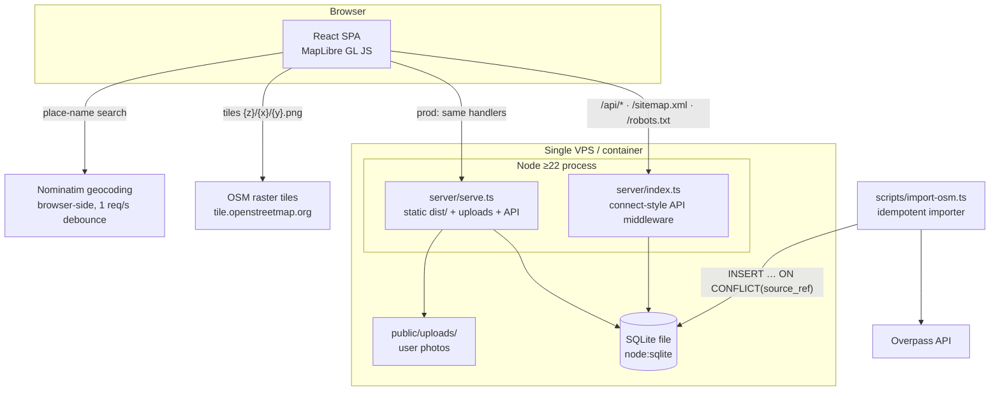

# Nerde.com — Architecture

> **Status:** pinned decisions documented, not open for redesign.
> Source of truth: [CONTRACTS.md](CONTRACTS.md) §1 (stack), §2 (layout), §3 (URLs), §6 (API).
> Database/geospatial detail lives in [DATABASE.md](DATABASE.md); SEO rationale in `SEO_STRATEGY.md`;
> OSM tag mapping in `DATA_SOURCES.md`.

Nerde.com is a **map-first SPA** for discovering highly specific categories of physical places,
backed by a **single Node process** (API + static hosting) and a **single SQLite file**.
One machine, one process, one database file — deliberately the smallest architecture that
satisfies the MVP, with every scale-out path documented below.

---

## 1. System overview

### 1.1 ASCII

```
                        ┌───────────────────────────────────────┐
                        │                Browser                 │
                        │  React 18 SPA (Vite build)             │
                        │  MapLibre GL JS · supercluster         │
                        │  client-side photo resize (canvas)     │
                        └───┬──────────────┬──────────────┬─────┘
              /api/* JSON   │              │ raster tiles │ geocode (Nominatim,
              sitemap.xml   │              │              │  ≤1 req/s, debounced)
              robots.txt    │              │              │
        ┌───────────────────▼───┐   ┌──────▼──────────────▼─────┐
        │   Node ≥ 22 server    │   │  OpenStreetMap services   │
        │ dev:  Vite dev server │   │  tile.openstreetmap.org   │
        │        + API          │   │  nominatim.openstreetmap  │
        │       middleware      │   │        .org               │
        │       (:7100)         │   └───────────────────────────┘
        │ prod: server/serve.ts │                ▲
        │  (dist/ + uploads/ +  │                │ © OpenStreetMap contributors
        │   same API handlers)  │                │ (attribution rendered in UI)
        └───────┬───────────────┘
                │ node:sqlite (DatabaseSync, prepared stmts)
        ┌───────▼───────────────┐
        │ SQLite file           │◀─────────┐
        │ (NERDE_DB_PATH)       │          │ upsert ON CONFLICT(source_ref)
        └───────────────────────┘          │
        uploads dir (NERDE_UPLOAD_DIR)  ┌──┴────────────────┐    ┌───────────────┐
        user photos, client-resized     │ scripts/          │───▶│ Overpass API  │
                                        │ import-osm.ts     │    │ (OSM tags →   │
        scripts/seed.ts ───────────────▶│ (idempotent,      │    │  Nerde cats)  │
        (categories, admin, curated)    │  source_ref PK)   │    └───────────────┘
                                        └───────────────────┘
```

### 1.2 Mermaid



**Data-flow summary**

- The browser talks to **four** things: our Node server (`/api/*`, SEO files), the OSM raster
  tile CDN, and Nominatim (geocoding). Nothing else — no third-party JS, no analytics beacons.
- The Node server is the **only** writer/reader of SQLite at runtime.
- The OSM importer is an **offline batch script** (`npm run import:osm`), not a runtime dependency.
- `sitemap.xml` / `robots.txt` are generated by the same middleware (see CONTRACTS §6, "SEO infra").

---

## 2. Stack decisions, alternatives, and migration paths

All rows of CONTRACTS §1 are binding. This section records *why*, and the *exit ramp* for each.

### 2.1 Frontend — React 18 + TypeScript + Vite 7 SPA + Tailwind 3.4 + shadcn/ui

| | |
|---|---|
| **Decision** | Client-rendered SPA, `react-router-dom` v6/v7, built by Vite to `dist/` |
| **Alternatives** | Next.js SSR/SSG · Remix · SvelteKit · Astro islands |
| **Why (MVP)** | Local toolchain mandate; fastest dev loop; the product is a map — a stateful, gesture-heavy canvas where per-interaction server rendering buys nothing. Zero server-rendering infrastructure to operate. |
| **Known weakness** | SEO: crawlers get an SPA shell. Mitigated now by `/sitemap.xml`, `/robots.txt`, per-route `<title>`/meta/JSON-LD injection (`src/lib/seo.ts`), permanent semantic URLs (`/c/:slug`, `/place/:slug`), and server-rendered sitemap content. Google renders JS, but indexing is slower/less reliable than SSR. |
| **Upgrade path (SPA → SSR)** | In order of increasing effort: **(a)** build-time pre-render of `/c/:slug` + top-N `/place/:slug` pages (vite-plugin-prerender style) — no app rewrite; **(b)** react-router v7 SSR / Vite SSR mode — same components, server renders the route tree; **(c)** Next.js App Router port — heaviest, only if (a)/(b) prove insufficient. The routing/component structure is kept framework-orthodox so (b) stays cheap. Trigger: when organic-search share of traffic matters more than dev velocity, or crawl stats show poor place-page indexation. Detailed in `SEO_STRATEGY.md`. |

### 2.2 Map — MapLibre GL JS + OSM raster tiles

| | |
|---|---|
| **Decision** | `maplibre-gl` with raster source `https://tile.openstreetmap.org/{z}/{x}/{y}.png`; clustering via GeoJSON source `cluster: true` (supercluster, built in) |
| **Alternatives** | Mapbox GL (token, per-load billing, lock-in) · Google Maps JS (billing, lock-in, ToS restricts data layering) · Leaflet (fine, but no vector future, weaker gesture/GPU path) |
| **Why (MVP)** | No API key, no account, no bill at MVP scale (within the OSM Tile Usage Policy: modest volume, attribution shown, standard caching respected). MapLibre is the open fork of Mapbox GL v1 — the API we code against is the same one a vector future uses. Clustering is free and proven (supercluster). |
| **Upgrade path (raster → vector)** | Self-host **Protomaps/PMTiles**: one static `.pmtiles` file (planet or region extracts) served from the same VPS or Cloudflare R2 + a MapLibre style JSON. **Map code does not change** — only the style/source URL. Intermediate step: any hosted vector provider that speaks MapLibre styles. Trigger: OSM tile-policy limits (traffic growth), need for custom cartography (e.g. de-emphasize roads), or offline/whitelabel needs. |
| **Lock-in check** | All map interaction code depends on the MapLibre API, not on OSM endpoints; both tile source and geocoder are URL-configurable. |

### 2.3 Backend — Node HTTP API as Vite dev middleware + `server/serve.ts` in prod

| | |
|---|---|
| **Decision** | `server/index.ts` is a connect-style middleware `(req,res,next)` handling `/api/*`, `/sitemap.xml`, `/robots.txt`. In dev it is mounted via a small Vite plugin (`configureServer`); in prod `server/serve.ts` mounts the same handlers in a plain `node:http` server that also serves `dist/` and `uploads/`. |
| **Alternatives** | Separate Express/Fastify service on a second port · serverless functions (Vercel/CF Workers) · Supabase (hosted PG + PostgREST + Auth) |
| **Why (MVP)** | One command (`npm run dev`), one port (7100), no CORS config, no second process, no deploy target beyond "a Node box". Handler signature is connect-compatible, so the code is portable, not Vite-coupled. |
| **Upgrade path** | The same handlers mount into Express/Fastify/Hono unchanged → standalone API service if the frontend ever moves to a separate host or CDN. Horizontal split: static `dist/` to a CDN, API to N node instances (requires moving rate-limit buckets out of memory — see §6.1 — and SQLite → Postgres, see DATABASE.md §7). |
| **Runtime note** | Node ≥ 22.18 (24 on the dev machine), native TypeScript type-stripping for `server/` + `scripts/` — **erasable TS only** (no enums, parameter properties, namespaces); zero build step for server code. |

### 2.4 Database — SQLite via `node:sqlite` (`DatabaseSync`)

| | |
|---|---|
| **Decision** | Single SQLite file (`NERDE_DB_PATH`), accessed with the built-in driver; prepared statements only; WAL mode; foreign keys on. |
| **Alternatives** | PostgreSQL + PostGIS (MASTER_PROMPT §23 suggests considering it) · Supabase · Turso/libSQL · MySQL spatial |
| **Why (MVP)** | Zero dependencies, zero services, zero credentials; backup = copy one file; read-heavy bbox workloads with a B-tree index are single-digit-ms at MVP scale (tens of thousands of places, ≤1000 rows per viewport query). `node:sqlite` is in stdlib — nothing to install, nothing to version-drift. Full SQL is available, including `json_extract` and `ON CONFLICT` upserts, which the design uses heavily. |
| **Honest trade-off** | No real geospatial type/index (bbox = two range predicates + JS haversine), single-writer concurrency, `json_extract` filters don't use an index. All three are quantified with thresholds and a full PostGIS migration design in [DATABASE.md](DATABASE.md) §6–7. |
| **Upgrade path (SQLite → PostGIS)** | Schema maps 1:1 (`attrs TEXT`→`JSONB`, add `geom geography(Point,4326)` + GiST); data moves by CSV/JSONL dump → `COPY`; query layer changes are confined to the bbox/nearest/duplicate SQL (already isolated — DATABASE.md §5 vs §7). Trigger: sustained write contention, ≥ ~1M places with slow viewport queries, or need for server-side clustering. |

### 2.5 Auth — email + password, scrypt, httpOnly session cookie

| | |
|---|---|
| **Decision** | `scrypt` from `node:crypto` (`scrypt$N$r$p$salt$hash` hex), random session token in `sessions` table, cookie `nerde_session`: `HttpOnly; SameSite=Lax; 30-day` (+ `Secure` behind HTTPS in prod). |
| **Alternatives** | Google OAuth (**deferred**, not rejected — documented) · Auth0/Clerk/Supabase Auth (vendor dependency, cost, overkill) · JWT (revocation pain for no MVP benefit) |
| **Why (MVP)** | Stdlib crypto, server-side revocation = `DELETE FROM sessions`, no token refresh dance, no third party holding our user table. |
| **Upgrade path** | Add `oauth_accounts(user_id, provider, provider_user_id)` later; Google sign-in mints the same `sessions` row/cookie. No change to session model. |

### 2.6 Photos — client-side canvas resize → base64 JSON → `public/uploads/`

| | |
|---|---|
| **Decision** | Browser canvas resize to ≤1600 px JPEG q0.8 → base64 in JSON `POST /api/photos` → server validates (magic bytes, ≤3 MB) → `public/uploads/<nanoid>.jpg`, served as static files. |
| **Alternatives** | S3/R2 + presigned multipart uploads · server-side `sharp` (native dep) · imgix/Cloudinary |
| **Why (MVP)** | No native deps, no buckets, no keys. Bandwidth and CPU for resizing are pushed to the client; the server only ever stores small, already-sanitized JPEG/PNG. Bonus privacy: canvas re-encode **strips EXIF** (incl. GPS) by construction. |
| **Upgrade path** | Storage is behind one code path (`POST /api/photos` → `{url}`); swap the writer to S3/R2 and serve via CDN; old files migrate lazily by URL prefix. Contract (`photos.url`) unchanged. |

### 2.7 Geocoding — Nominatim from the browser

| | |
|---|---|
| **Decision** | Place-name search calls `nominatim.openstreetmap.org` directly from the browser, ≤1 req/s with client debounce, attribution shown. |
| **Alternatives** | Mapbox/Google geocoder (keys, billing) · self-hosted Nominatim/Photon |
| **Why (MVP)** | Zero keys, zero cost at MVP volume; keeps our server out of the geocoding path. |
| **Upgrade path** | Self-host Photon/Nominatim (or buy hosted geocoding) and change one base URL. Trigger: usage-policy pressure or UX need for autocomplete quality. |

### 2.8 Platform — responsive web SPA, **no native apps**

MASTER_PROMPT §29 explicitly defers native iOS/Android. Mobile web is a first-class surface
(map + floating controls, §21). Path if ever needed: PWA install prompts → Capacitor wrapper
reusing the SPA and API. Nothing in the architecture assumes a desktop browser.

### 2.9 Analytics — first-party `events` table

See §7. No GA/Mixpanel/PostHog at MVP (privacy stance, MASTER_PROMPT §25).

---

## 3. Frontend / backend boundary

### 3.1 Client-side routes (react-router; all render `index.html` shell)

| Route | Page | Data source |
|---|---|---|
| `/` | Map-first home (the product IS the homepage) | `/api/categories`, `/api/places?bbox=…` |
| `/c/:slug` | Category map + SEO text block | `/api/categories`, `/api/places?bbox=&cat=` |
| `/place/:slug` | Place detail | `/api/places/:slug` |
| `/add?lat=&lng=` | Add Place flow (5 steps) | `/api/categories`, `/api/places/near` (dup check), `POST /api/places`, `POST /api/photos` |
| `/saved` | Favorites | `/api/me/saved` |
| `/login` | Sign in / sign up | `/api/auth/*` |
| `/admin` | Admin panel (role-gated) | `/api/admin/*` |
| `/u/:username` | Minimal public profile (optional, cheap) | places/comments APIs |

Reserved, **not built**: `/c/:slug/:country`, `/c/:slug/:country/:city` (see `SEO_STRATEGY.md`).

### 3.2 Server surface (owned by `server/`)

- JSON API: everything under `/api/*` — exactly the endpoints, shapes, status codes, rate
  limits and spam rules pinned in **CONTRACTS §6** (public, auth, user, admin). This document
  does not restate them; §6 is the contract.
- SEO infra (not under `/api`): `GET /sitemap.xml` (static URLs + all categories + published
  places), `GET /robots.txt` — generated from the DB on each request.
- Static in prod: `dist/` (hashed assets → `Cache-Control: immutable`), `uploads/` (photos),
  SPA fallback → `index.html` for all non-API GETs.

### 3.3 Dev vs prod wiring

| | Dev | Prod |
|---|---|---|
| Command | `npm run dev` | `npm run build` then `npm start` (`node server/serve.ts`) |
| Port | **7100** (default) | `PORT` env (7100 default) |
| Frontend | Vite dev server, HMR | pre-built `dist/`, immutable cache headers |
| API | Vite plugin: `configureServer(s => s.middlewares.use(api))` — same `server/index.ts` handler runs in-process before Vite's own middleware | `serve.ts`: `node:http` → routes `/api/*`, `/sitemap.xml`, `/robots.txt` to the same handler; else static/SPA fallback |
| Server-code reload | restart `npm run dev` (server code is not HMR'd) | restart process |
| DB | same SQLite file path resolution (`NERDE_DB_PATH`) | same |

**Key invariant:** one handler module, two mounts. Dev and prod can never drift apart in
API behavior — the only differences are asset serving and HMR.

### 3.4 Request lifecycles (the three that matter)

1. **Viewport load:** `moveend` (debounced ~300 ms, in-flight fetch aborted) →
   `GET /api/places?bbox=w,s,e,n&cat=…&attrs=…&limit=500` → bbox+status SQL (DATABASE.md §5.1)
   → ≤1000 `PlaceSummary` → replaced into the MapLibre GeoJSON source → supercluster renders
   clusters/markers client-side.
2. **Place view:** click marker → preview card (data already client-side) → navigate
   `/place/:slug` → `GET /api/places/:slug` (4 queries, DATABASE.md §5.6) → detail panel/page;
   `place_viewed` event fire-and-forget (`POST /api/events`, always 204).
3. **Add place:** pin → `GET /api/places/near?lat&lng&radius_km=…` drives the
   *"Is this already one of these places?"* step → submit `POST /api/places` → server-side
   duplicate scan (≤100 m AND (shared category OR name-similar)) → `409 {duplicates}` unless
   `force:true` → `201 {place:{id,slug}}` → photos uploaded per-file via `POST /api/photos`.

---

## 4. Deployment architecture

### 4.1 Local dev

```bash
cd app
cp .env.example .env      # once
npm run seed              # categories + attributes + admin + curated places
npm run dev               # http://localhost:7100 — SPA + API + HMR
```

### 4.2 Production — one cheap VPS or one container

```
Internet ──▶ Caddy/nginx (TLS, Let's Encrypt, gzip/brotli, proxy :443 → :7100)
                   │
                   ▼
           node server/serve.ts            (single process, systemd unit or container)
             ├── dist/  (SPA build)
             ├── uploads/ (NERDE_UPLOAD_DIR)
             └── SQLite  (NERDE_DB_PATH)
```

- **Build:** `npm ci && npm run build`. **Run:** `node server/serve.ts` (`npm start`).
- **Container option:** single `Dockerfile` — `node:24` base → copy → `npm ci` → `npm run build`
  → `CMD ["node","server/serve.ts"]`; mount one volume for DB + uploads. No compose needed
  (no sidecar services).
- **Backups:** SQLite online backup (file copy while WAL-checkpointed, or `VACUUM INTO`) +
  `uploads/` → daily cron rsync/object-storage. Optional later: Litestream for continuous
  replication. Restore = put the file back.
- **Migrations:** `db/migrations/001_init.sql` and up, applied by `db.ts` at startup
  (idempotent `CREATE TABLE IF NOT EXISTS`-style runner tracking applied files).

### 4.3 Environment variables (`app/.env.example` is the contract)

| Var | Purpose |
|---|---|
| `PORT` | listen port (default 7100) |
| `NERDE_DB_PATH` | SQLite file location |
| `NERDE_UPLOAD_DIR` | photo storage dir (default `public/uploads/`) |
| `NERDE_ADMIN_EMAIL` / `NERDE_ADMIN_PASSWORD` | seed admin (defaults `admin@nerde.local` / `nerde-admin-2026` — **change in prod**) |
| `NERDE_OSM_ATTRIBUTION_EMAIL` | contact email sent in Overpass/importer User-Agent (OSM etiquette) |

### 4.4 Cost at MVP scale (near-zero by design)

| Item | Monthly cost |
|---|---|
| VPS 2 vCPU / 2–4 GB (Hetzner/DigitalOcean class) | **$5–10** |
| Domain | ~$1 (≈$12/yr) |
| OSM raster tiles | $0 — within OSM Tile Usage Policy at MVP traffic (attribution, standard caching, no bulk download) |
| Nominatim geocoding | $0 — browser-side, debounced ≤1 req/s |
| Object storage / CDN | $0 — photos on VPS disk |
| Analytics | $0 — first-party `events` table |
| Auth/email | $0 — no email sending at MVP (no verification emails in scope); add a $0-tier transactional provider when needed |
| **Total** | **≈ $6–12 / month** |

**Cost triggers to watch:** OSM tile-policy pressure → Protomaps/PMTiles self-host (~$0–20/mo
R2/CDN); place count / write contention → managed Postgres (~$15–25/mo); traffic → CDN in
front of `dist/` (cheap, static).

---

## 5. Performance plan

### 5.1 MVP techniques (all specified, most pinned by contract)

| Technique | Where |
|---|---|
| Bounding-box SQL with `places_lat_lng` index + `status` filter | DATABASE.md §5.1 — never a full-table geo scan |
| **500–1000 place cap per viewport fetch** (`limit` default 500, max 1000) | CONTRACTS §6; server enforces cap |
| Client-side clustering: MapLibre GeoJSON `cluster: true` (supercluster) | markers/cluster counts render at 60 fps even at the 1000-point cap |
| Debounced `moveend` refetch (~300 ms) + abort in-flight requests | prevents request storms while panning |
| Lazy images (`loading="lazy"`), photos pre-resized ≤1600 px q0.8 by the client | place pages and cards stay light |
| Categories fetched once and cached client-side; static assets hashed + immutable caching | repeat visits ~0 network for chrome |
| Prepared statements, sync driver on a local NVMe file | single-digit-ms API reads |
| `sitemap.xml` generated per request from indexed queries | fine at MVP; cache/shard later (DATABASE.md §5.5) |

### 5.2 Scaling path to 1M+ places

| Scale | Change |
|---|---|
| ~100k places | Nothing structural. Add secondary indexes (DATABASE.md §6), `ANALYZE`, maybe cache hot bbox responses in memory. |
| ~1M | SQLite still fine for indexed reads; move to **PostGIS** when write contention or filter latency appears (DATABASE.md §7). Add **server-side clustering**: low zooms return cluster aggregates (grid/`ST_ClusterKMeans`/h3 cells) instead of raw points; API gains a zoom-aware response (`{clusters:[…]}` vs `{places:[…]}`). |
| ~10M | Pre-generated **place vector tiles** (tippecanoe → PMTiles) for the dot layer — viewport rendering becomes tile-serving (CDN-able); API only serves place *details*, filters, and search. Postgres read replica if needed. Static `dist/` + tiles behind CDN; API horizontally scaled (rate limits move to Redis). |

The frontend is already written against "fetch what you see, cluster what you get", so every
step above is a backend/API-shape change, not a UI rewrite.

---

## 6. Security & privacy

### 6.1 Application security (MVP baseline, per CONTRACTS §6–7)

- **Passwords:** `scrypt` (`node:crypto`), per-user salt, `scrypt$N$r$p$salt$hash` hex,
  `timingSafeEqual` comparison.
- **Sessions:** 256-bit random token, `sessions` table, cookie `nerde_session` —
  `HttpOnly` (no JS access → XSS can't steal it), `SameSite=Lax` (CSRF baseline),
  30-day expiry, server-side revocation; `Secure` in prod behind TLS.
- **CSRF:** SameSite=Lax + JSON-only mutation endpoints (`Content-Type` checked) is
  sufficient at MVP; token-based CSRF noted as a later hardening.
- **Rate limits:** in-memory token bucket — all POST endpoints **30/min/IP**, photos
  **10/min/IP**. In-memory is per-process (fine for one process; move to Redis/DB when
  multi-instance). Resets on restart — accepted MVP trade-off.
- **Spam:** honeypot field `website` on `POST /api/places` (filled → fake 200, nothing
  persisted); length caps on comments (1–500)/reports; one active verification vote per
  user per place (latest wins).
- **Uploads:** JPEG/PNG **magic-byte** validation server-side, ≤3 MB after client resize,
  `<nanoid>.jpg` names (no user-controlled paths), never SVG, served with
  `X-Content-Type-Options: nosniff`; client canvas re-encode strips EXIF/GPS.
- **Input validation:** lat∈[-90,90], lng∈[-180,180]; name 2–80 chars; ≥1 category;
  `attrs` keys must exist in `category_attributes` for the place's categories; attribute
  filter keys validated against the same table before they ever reach a JSON path.
- **SQL injection:** `node:sqlite` prepared statements exclusively; values and JSON paths
  bound as parameters, never concatenated.
- **XSS:** React escaping by default, no `dangerouslySetInnerHTML` for user content,
  server-side trim/escape as defense in depth.
- **Authorization:** every `/api/admin/*` handler re-checks `role='admin'` server-side;
  ownership checks on user endpoints.

### 6.2 Location privacy (MASTER_PROMPT §28 — explicit architectural rule)

- **Near Me** uses the **browser Geolocation API only**. Coordinates leave the device solely
  as query params of `GET /api/places/near` for that search. They are **never persisted**:
  no columns, no logs-by-design, and the `near_me_used` analytics event carries **no
  coordinates**.
- **User-contributed places are public data** — that is the product. The distinction
  "public place data ≠ tracking users" is deliberate and documented.
- Photos carry no EXIF/GPS (canvas re-encode). Analytics store no IPs (see §7).

---

## 7. Analytics

### 7.1 Design

First-party only. Table (schema detail in DATABASE.md §2):

```text
events(id PK, type TEXT, user_id INTEGER NULL, meta TEXT JSON DEFAULT '{}', created_at)
```

- Ingestion: `POST /api/events {type, meta?}` → **always 204** (fire-and-forget; analytics
  can never break UX or leak errors into the UI). Light server-side validation of `type`.
- Privacy: **no IP storage**, no user agent fingerprinting, `user_id` only when logged in,
  `meta` carries product context (category slug, place id, query string, filter keys) and
  **never** PII or precise device location.
- Rationale vs third parties: GA/Mixpanel would conflict with the privacy stance
  (MASTER_PROMPT §25) and send our category-intent data to a third party. A self-hosted
  Plausible/Umami can be added later *alongside*; `events` remains the product-funnel
  source of truth.

### 7.2 Tracked events (MASTER_PROMPT §25 — exact names)

`category_selected` · `search_performed` · `place_viewed` · `place_saved` ·
`add_place_started` · `place_submitted` · `place_verified` · `place_reported` ·
`filter_applied` · `near_me_used`

Example `meta`: `{"category":"calisthenics"}` · `{"q":"van parking munich"}` ·
`{"place_id":123,"category":"vanlife"}` · `{"attrs":["vanlife.free","vanlife.toilet"]}`.

### 7.3 Funnel queries (success metrics, MASTER_PROMPT §26)

```sql
-- 7-day core funnel: search → view → save → contribution
SELECT
  SUM(type = 'search_performed') AS searches,
  SUM(type = 'place_viewed')     AS place_views,
  SUM(type = 'place_saved')      AS saves,
  SUM(type = 'add_place_started')AS add_starts,
  SUM(type = 'place_submitted')  AS submissions,
  SUM(type = 'place_verified')   AS verifications
FROM events
WHERE created_at >= datetime('now', '-7 days');
```

Per-category density/engagement = `events.meta ->> '$.category'` grouped, joined against
`place_categories`; returning users = `users`/`sessions` age vs `events` activity.
The strongest PMF signal — *unprompted contributions* — is
`place_submitted` where `places.source = 'community'` and `created_by` is a non-seed user.

---

## 8. Explicitly deferred (with their re-entry points)

| Deferred | Re-entry point |
|---|---|
| SSR / pre-rendering for SEO | §2.1 — pre-render → RR v7 SSR → Next.js |
| Vector tiles / custom cartography | §2.2 — Protomaps PMTiles, style swap only |
| PostGIS | DATABASE.md §7 — full schema + query mapping |
| Google OAuth | §2.5 — `oauth_accounts` table, same sessions |
| Server-side clustering / place vector tiles | §5.2 — zoom-aware API, then PMTiles |
| S3/R2 photo storage, thumbnails pipeline | §2.6 — swap storage writer |
| Redis rate limits, multi-instance API | §6.1 — when scaling past one process |
| i18n (Turkish next) | `src/lib/strings.ts` English source object; DB Unicode-clean (CONTRACTS §7) |
