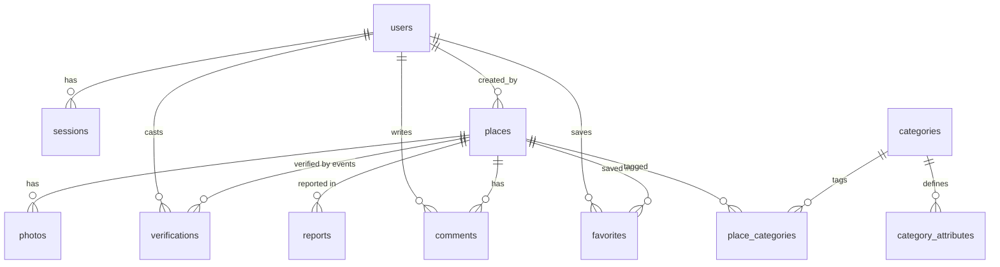

# Nerde.com — Database & Geospatial Design

> **Status:** schema pinned by [CONTRACTS.md](CONTRACTS.md) §5 — table/column names here are
> **exactly** those of `db/migrations/001_init.sql`. This document adds rationale, the exact
> query set, the index/scale plan, and the PostGIS migration path. Do not rename anything.
> Engine: **SQLite** via built-in `node:sqlite` (`DatabaseSync`).

---

## 1. Conventions

- **Keys:** `INTEGER PRIMARY KEY` (rowid alias) everywhere except natural PKs (`sessions.token`)
  and composite junction PKs (`place_categories`, `favorites`).
- **Timestamps:** `TEXT` in `datetime('now')` format (`YYYY-MM-DD HH:MM:SS`, UTC). One format
  everywhere so string comparison = chronological comparison. Relative display
  ("Verified 12 days ago") is computed client-side.
- **Booleans:** SQLite has none — `INTEGER` 0/1 (e.g. `category_attributes.filterable`).
- **JSON columns:** plain `TEXT` (`places.attrs`, `category_attributes.options`,
  `events.meta`), read/written with SQLite's built-in `json_extract`/`json_type`.
- **Operational pragmas** (set per connection in `db.ts`, and at the top of the migration):
  `PRAGMA journal_mode = WAL;` (persists in the DB file) and `PRAGMA foreign_keys = ON;`
  (per-connection — **must** be re-set on every open).
- **Soft delete:** `places.status` (`published|pending|removed`) — rows are never hard-deleted
  by user-facing flows. Public queries always filter `status = 'published'`.

---

## 2. Schema — reference for `db/migrations/001_init.sql`

```sql
-- ============================================================================
-- Nerde.com — 001_init.sql
-- SQLite (node:sqlite / DatabaseSync). Names pinned by CONTRACTS.md §5.
-- ============================================================================

PRAGMA journal_mode = WAL;        -- persists in the DB file
PRAGMA foreign_keys = ON;         -- per-connection: set again on every open in db.ts

-- ── Accounts ────────────────────────────────────────────────────────────────

CREATE TABLE users (
  id            INTEGER PRIMARY KEY,
  email         TEXT UNIQUE NOT NULL,
  username      TEXT UNIQUE NOT NULL,
  password_hash TEXT NOT NULL,                   -- scrypt$N$r$p$salt$hash (hex), node:crypto
  role          TEXT NOT NULL DEFAULT 'user',    -- user | admin
  created_at    TEXT NOT NULL DEFAULT (datetime('now'))
);

CREATE TABLE sessions (
  token      TEXT PRIMARY KEY,                   -- 256-bit random hex
  user_id    INTEGER NOT NULL REFERENCES users(id),
  created_at TEXT NOT NULL DEFAULT (datetime('now')),
  expires_at TEXT NOT NULL                       -- 30-day sessions; sweep periodically
);

-- ── Category system ─────────────────────────────────────────────────────────

CREATE TABLE categories (
  id    INTEGER PRIMARY KEY,
  slug  TEXT UNIQUE NOT NULL,                    -- kebab-case: 'calisthenics', 'arm-wrestling'
  name  TEXT NOT NULL,
  icon  TEXT NOT NULL DEFAULT '📍',              -- emoji, rendered as marker badge
  color TEXT NOT NULL DEFAULT '#2563eb',         -- marker/chip color
  grp   TEXT NOT NULL DEFAULT 'outdoor',         -- fitness | outdoor | future groups
  sort  INTEGER NOT NULL DEFAULT 0               -- UI ordering within group
);

-- Attribute DEFINITIONS (relational): drive the filter UI, the add-place form,
-- and server-side validation of places.attrs keys. Adding a category or an
-- attribute = INSERT rows, never a migration.
CREATE TABLE category_attributes (
  id          INTEGER PRIMARY KEY,
  category_id INTEGER NOT NULL REFERENCES categories(id),
  key         TEXT NOT NULL,                     -- snake_case: 'pull_up_bars'
  label       TEXT NOT NULL,                     -- UI label: 'Pull-up bars'
  type        TEXT NOT NULL,                     -- bool | enum | number | text
  options     TEXT,                              -- JSON array, enum only: '["outdoor","indoor"]'
  filterable  INTEGER NOT NULL DEFAULT 0,        -- 1 → shown as a filter chip
  sort        INTEGER NOT NULL DEFAULT 0,
  UNIQUE (category_id, key)
);

-- ── Places ──────────────────────────────────────────────────────────────────

CREATE TABLE places (
  id               INTEGER PRIMARY KEY,
  slug             TEXT UNIQUE NOT NULL,         -- slugified name + short id:
                                                 -- 'macka-calisthenics-park-a3f9'; NEVER changes
  name             TEXT NOT NULL,                -- validated 2–80 chars
  description      TEXT NOT NULL DEFAULT '',
  lat              REAL NOT NULL,                -- WGS84 degrees, validated [-90, 90]
  lng              REAL NOT NULL,                -- WGS84 degrees, validated [-180, 180]
  address          TEXT NOT NULL DEFAULT '',
  city             TEXT NOT NULL DEFAULT '',
  region           TEXT NOT NULL DEFAULT '',
  country          TEXT NOT NULL DEFAULT '',
  country_code     TEXT NOT NULL DEFAULT '',     -- ISO 3166-1 alpha-2
  attrs            TEXT NOT NULL DEFAULT '{}',   -- JSON object, keys namespaced
                                                 -- '<category_slug>.<attr_key>':
                                                 -- {"calisthenics.pull_up_bars":true,
                                                 --  "vanlife.quiet":true, ...}
  status           TEXT NOT NULL DEFAULT 'published',  -- published | pending | removed
  source           TEXT NOT NULL DEFAULT 'community',  -- community | osm | curated
  source_ref       TEXT,                         -- 'osm:node/123' | 'osm:way/456' | 'osm:relation/789'
                                                 -- NULL for community/curated rows
  created_by       INTEGER REFERENCES users(id), -- NULL for imports/system rows
  created_at       TEXT NOT NULL DEFAULT (datetime('now')),
  updated_at       TEXT NOT NULL DEFAULT (datetime('now')),
  -- denormalized verification cache (source of truth = verifications table, §5.4)
  last_verified_at TEXT,                         -- set by 'confirm' votes only
  confirm_count    INTEGER NOT NULL DEFAULT 0,
  issue_count      INTEGER NOT NULL DEFAULT 0
);

-- Idempotent OSM import anchor: one row per external object, NULLs exempt.
CREATE UNIQUE INDEX places_source_ref ON places(source_ref) WHERE source_ref IS NOT NULL;
-- Geo: two-range bbox scans (lat range via index, lng filtered within the range).
CREATE INDEX places_lat_lng ON places(lat, lng);
-- Every public query filters status = 'published'.
CREATE INDEX places_status ON places(status);

-- Many-to-many: a place has N categories, a category has N places.
-- PK serves place → categories (place detail); pc_cat serves category → places (filters).
CREATE TABLE place_categories (
  place_id    INTEGER NOT NULL REFERENCES places(id),
  category_id INTEGER NOT NULL REFERENCES categories(id),
  PRIMARY KEY (place_id, category_id)
);
CREATE INDEX pc_cat ON place_categories(category_id, place_id);

-- ── Place content & community ───────────────────────────────────────────────

CREATE TABLE photos (
  id         INTEGER PRIMARY KEY,
  place_id   INTEGER NOT NULL REFERENCES places(id),
  url        TEXT NOT NULL,                      -- '/uploads/<nanoid>.jpg'
  width      INTEGER,
  height     INTEGER,
  created_by INTEGER REFERENCES users(id),
  created_at TEXT NOT NULL DEFAULT (datetime('now'))
);

CREATE TABLE favorites (
  user_id    INTEGER NOT NULL REFERENCES users(id),
  place_id   INTEGER NOT NULL REFERENCES places(id),
  created_at TEXT NOT NULL DEFAULT (datetime('now')),
  PRIMARY KEY (user_id, place_id)
);

-- Append-only event log; places.confirm_count/issue_count are a derived cache.
CREATE TABLE verifications (
  id         INTEGER PRIMARY KEY,
  place_id   INTEGER NOT NULL REFERENCES places(id),
  user_id    INTEGER REFERENCES users(id),       -- nullable for forward compat
  type       TEXT NOT NULL,                      -- confirm | issue
  note       TEXT NOT NULL DEFAULT '',
  created_at TEXT NOT NULL DEFAULT (datetime('now'))
);

CREATE TABLE reports (
  id         INTEGER PRIMARY KEY,
  place_id   INTEGER NOT NULL REFERENCES places(id),
  user_id    INTEGER REFERENCES users(id),       -- NULL → anonymous report
  reason     TEXT NOT NULL,
  note       TEXT NOT NULL DEFAULT '',
  status     TEXT NOT NULL DEFAULT 'open',       -- open | resolved | dismissed
  created_at TEXT NOT NULL DEFAULT (datetime('now'))
);

CREATE TABLE comments (
  id         INTEGER PRIMARY KEY,
  place_id   INTEGER NOT NULL REFERENCES places(id),
  user_id    INTEGER NOT NULL REFERENCES users(id),
  body       TEXT NOT NULL,                      -- validated 1–500 chars
  status     TEXT NOT NULL DEFAULT 'published',  -- published | removed
  created_at TEXT NOT NULL DEFAULT (datetime('now'))
);

-- First-party product analytics (§7 of ARCHITECTURE.md). No IPs, no PII,
-- no precise device location in meta.
CREATE TABLE events (
  id         INTEGER PRIMARY KEY,
  type       TEXT NOT NULL,                      -- category_selected | search_performed | ...
  user_id    INTEGER,                            -- NULL → anonymous; NOT a hard FK
  meta       TEXT NOT NULL DEFAULT '{}',         -- JSON: {"category":"calisthenics",...}
  created_at TEXT NOT NULL DEFAULT (datetime('now'))
);
```

### Entity relationships



---

## 3. Design rationale

### 3.1 Many-to-many `places` ↔ `categories`

MASTER_PROMPT §2 is explicit: one park can be calisthenics + drinking-water + basketball, so
one-category-per-place is a non-starter. `place_categories` with composite
`PRIMARY KEY (place_id, category_id)`:

- prevents duplicate links structurally,
- serves **place → categories** via the PK (place detail page),
- serves **category → places** via `pc_cat` (viewport/category filters),
- keeps category membership independent of `places.attrs` (membership can exist with zero
  attributes filled in).

### 3.2 Hybrid attribute model: relational definitions + JSON values

Split deliberately:

- **Definitions are relational** (`category_attributes`): they drive the filter UI, the
  add-place form, server-side validation (`attrs` keys must exist for that category —
  CONTRACTS §6), labels/types/enum options, and the admin attribute editor. This is metadata —
  it must be queryable and constrained, so it is *not* JSON.
- **Values live in `places.attrs`** as one JSON object keyed by `'<category_slug>.<key>'`.
  Namespacing is required because a place can hold several categories with overlapping keys
  (`free`, `lighting`, `indoor_outdoor` exist across many categories) — and slug-based keys
  stay stable if a category row is renumbered.

**Why not EAV rows** (`place_attributes(place_id, attribute_id, value)`):

- Place detail = N rows + application-side pivot instead of 1 JSON column.
- Every attribute filter = another self-join; a 3-filter bbox query becomes 4 joins deep.
- Write amplification and no useful indexing in SQLite — the filter becomes a join-then-scan
  either way, so nothing is gained over `json_extract` while costing far more complexity.

**Why not per-category tables** (`calisthenics_attrs`, `vanlife_attrs`, …):

- New category = schema migration + new code path — violates "support unlimited future
  categories without migrations" (MASTER_PROMPT §6).
- Multi-category places need multi-table joins; table names in dynamic SQL are an injection
  surface; the admin panel needs per-table code.

**Why not schemaless-only** (attrs JSON with no definitions table):

- No key/type validation (typos silently stored), no labels for the UI, no `filterable`
  metadata, nothing for the admin panel to edit. Filters could not be generated.

**Accepted trade-off:** attribute filters use `json_extract` and do **not** use a B-tree
index in SQLite. This is fine because every filter query is bbox-prefiltered (candidate set
≤1000 rows by contract) — `json_extract` runs over the bbox survivors, not the table. Escape
hatches, in order: SQLite **generated columns** indexed per hot attribute
(`ALTER TABLE places ADD COLUMN a_free INTEGER GENERATED ALWAYS AS (json_extract(attrs,'$."vanlife.free"')) VIRTUAL`
+ index) → PostGIS `jsonb` + GIN (§7).

### 3.3 Denormalized verification counters

`places.confirm_count` / `issue_count` / `last_verified_at` are a **cache** of the append-only
`verifications` log, maintained transactionally on each vote (§5.4) so the hot viewport query
never aggregates. The log is the source of truth and makes the future **confidence score**
(MASTER_PROMPT §12) computable without any schema change: per-event voter, timestamp, type,
note, plus `users.created_at` (account age) are all stored. A reputation column on `users`
can be added later without touching the log.

### 3.4 `TEXT` timestamps

`node:sqlite` has no native datetime; a single canonical format (`datetime('now')`, UTC)
keeps comparisons lexicographic = chronological and round-trips losslessly through JSON.

---

## 4. Geo model (SQLite MVP)

No spatial extension. Two primitives, per CONTRACTS §5:

- **bbox** = `lat BETWEEN ? AND ? AND lng BETWEEN ? AND ?`, with **antimeridian handling**:
  when `w > e` the longitude predicate becomes `(lng >= :w OR lng <= :e)`.
- **nearest** = bbox square prefilter in SQL + exact **haversine** distance computed and
  sorted in JS (prefilter is an over-approximation — the square contains the circle).

Degrees-per-km constants: `dlat = km / 111.32`, `dlng = km / (111.32 · cos(radians(lat)))`
(clamp `|lat| ≤ 89.9`; if `dlng ≥ 180`, drop the longitude predicate — the whole band matches).

---

## 5. The exact queries

Parameter style: named `:params` for readability (server binds positionally with
`DatabaseSync.prepare`). Every statement is prepared; values **and** JSON paths are bound
parameters — never concatenated.

### 5.1 Viewport listing — bbox + category + attribute filters

Serves `GET /api/places?bbox=w,s,e,n[&cat=slug][&attrs=k1,k2][&q=text][&limit=500]`.

```sql
SELECT p.id, p.slug, p.name, p.lat, p.lng,
       p.confirm_count, p.last_verified_at,
       (SELECT ph.url FROM photos ph
         WHERE ph.place_id = p.id ORDER BY ph.id LIMIT 1) AS photo_url
FROM places p
WHERE p.status = 'published'
  -- bounding box (antimeridian-safe)
  AND p.lat BETWEEN :s AND :n
  AND ( (:w <= :e AND p.lng BETWEEN :w AND :e)
     OR (:w >  :e AND (p.lng >= :w OR p.lng <= :e)) )
  -- optional category filter (repeat-safe single predicate)
  AND (:cat IS NULL OR p.id IN (
        SELECT pc.place_id FROM place_categories pc
        JOIN categories c ON c.id = pc.category_id
        WHERE c.slug = :cat))
  -- optional free-text (name/description LIKE), CONTRACTS §6
  AND (:q IS NULL OR p.name LIKE '%' || :q || '%'
                 OR p.description LIKE '%' || :q || '%')
  -- one generated predicate per requested 'cat.key' (see below)
  AND {attr_predicates}
ORDER BY p.id
LIMIT :limit;            -- server clamps: default 500, max 1000
```

For each key in the `attrs` query param (comma list of `cat.key` that must be **truthy**),
the server first validates the key against `category_attributes`, then appends one predicate
with the path bound as a parameter:

```sql
AND json_extract(p.attrs, :path_k) IS NOT NULL
AND json_extract(p.attrs, :path_k) NOT IN (0, '')
-- :path_k = '$."calisthenics.pull_up_bars"'   (quoted label: key contains a dot)
-- truthiness: JSON true→1, false→0, missing/null→SQL NULL, enum/text passes through
```

Categories for each returned place are hydrated with one batched query over the id set
(place → `pc_cat` PK direction), then mapped to `PlaceSummary.categories[]`.

### 5.2 Nearest-N — haversine with bbox prefilter

Serves `GET /api/places/near?lat=&lng=&radius_km=30[&cat=]` (max 50 results; also powers the
add-place duplicate UI).

```sql
-- SQL: over-approximating square prefilter (uses places_lat_lng)
-- :dlat = :radius_km / 111.32
-- :dlng = :radius_km / (111.32 * cos(radians(:lat)))   -- clamp/drop per §4
SELECT p.id, p.slug, p.name, p.lat, p.lng,
       p.confirm_count, p.last_verified_at,
       (SELECT ph.url FROM photos ph
         WHERE ph.place_id = p.id ORDER BY ph.id LIMIT 1) AS photo_url
FROM places p
WHERE p.status = 'published'
  AND p.lat BETWEEN :lat - :dlat AND :lat + :dlat
  AND p.lng BETWEEN :lng - :dlng AND :lng + :dlng   -- antimeridian variant as in 5.1
  AND (:cat IS NULL OR p.id IN (
        SELECT pc.place_id FROM place_categories pc
        JOIN categories c ON c.id = pc.category_id
        WHERE c.slug = :cat));
```

```js
// JS: exact distance, filter to the circle, sort, cap 50
const R = 6371; // km
const toRad = (d) => (d * Math.PI) / 180;
function haversineKm(lat1, lng1, lat2, lng2) {
  const dLat = toRad(lat2 - lat1), dLng = toRad(lng2 - lng1);
  const a = Math.sin(dLat / 2) ** 2 +
            Math.cos(toRad(lat1)) * Math.cos(toRad(lat2)) * Math.sin(dLng / 2) ** 2;
  return 2 * R * Math.asin(Math.sqrt(a));
}
// rows.map(r => ({...r, distance_km: haversineKm(lat, lng, r.lat, r.lng)}))
//   .filter(r => r.distance_km <= radius_km)
//   .sort((a, b) => a.distance_km - b.distance_km)
//   .slice(0, 50)
```

### 5.3 Duplicate detection (≤100 m AND (shared category OR name-similar))

Serves the `POST /api/places` pre-scan → `409 {duplicates:[PlaceSummary]}` unless `force:true`.

```sql
-- Step 1 (SQL): ~100 m square around the candidate (dlat/dlng for 0.1 km, §4).
-- Removed places are excluded; pending still blocks dupes.
SELECT p.id, p.slug, p.name, p.lat, p.lng
FROM places p
WHERE p.status <> 'removed'
  AND p.lat BETWEEN :lat - :dlat100 AND :lat + :dlat100
  AND p.lng BETWEEN :lng - :dlng100 AND :lng + :dlng100;
```

Step 2 (JS): keep rows with `haversineKm(...) <= 0.1`, then flag a duplicate when
**(a)** the candidate's category slugs intersect the existing place's slugs (batched
`place_categories` lookup), **or (b)** names are similar — normalize (lowercase, strip
non-alphanumerics, collapse spaces) and accept when one contains the other or a simple
edit-distance similarity ≥ 0.6. No ML, per MASTER_PROMPT §19.

### 5.4 Verification — vote transaction + aggregation

Serves `POST /api/places/:id/verify` — *one active vote per user per place, latest wins*.

```sql
-- One transaction:
-- (a) current active vote of this user on this place
SELECT id, type FROM verifications
 WHERE place_id = :place_id AND user_id = :user_id
 ORDER BY id DESC LIMIT 1;

-- (b) append the new event (log is never updated/deleted)
INSERT INTO verifications (place_id, user_id, type, note)
VALUES (:place_id, :user_id, :type, :note);

-- (c) adjust the cached counters by the delta of (new vote − replaced vote)
--     :d_confirm/:d_issue ∈ {+1, 0, −1}; last_verified_at moves on 'confirm' only
UPDATE places SET
  confirm_count    = confirm_count + :d_confirm,
  issue_count      = issue_count   + :d_issue,
  last_verified_at = CASE WHEN :type = 'confirm' THEN datetime('now')
                          ELSE last_verified_at END,
  updated_at       = datetime('now')
WHERE id = :place_id;
```

Reconciliation / recompute-from-log (source of truth; run as a consistency check or repair):

```sql
WITH latest AS (                      -- each user's newest vote per place
  SELECT place_id, user_id, MAX(id) AS id
  FROM verifications GROUP BY place_id, user_id
)
SELECT v.place_id,
       SUM(v.type = 'confirm') AS confirm_count,
       SUM(v.type = 'issue')   AS issue_count,
       MAX(CASE WHEN v.type = 'confirm' THEN v.created_at END) AS last_verified_at
FROM verifications v
JOIN latest l ON l.id = v.id
WHERE v.place_id = :place_id
GROUP BY v.place_id;
```

Recent verification activity for the place page:

```sql
SELECT v.type, v.note, v.created_at, u.username
FROM verifications v LEFT JOIN users u ON u.id = v.user_id
WHERE v.place_id = :place_id
ORDER BY v.id DESC LIMIT 10;
```

### 5.5 Sitemap generation (`GET /sitemap.xml`)

```sql
SELECT slug FROM categories ORDER BY sort, id;                              -- /c/:slug
SELECT slug, updated_at FROM places WHERE status = 'published' ORDER BY id; -- /place/:slug
```

Static routes (`/`, `/login`) come from code, not SQL. Protocol limits: shard into a
sitemap index when approaching 50 000 URLs / 50 MB; `updated_at` feeds `<lastmod>`.

### 5.6 Place detail assembly (`GET /api/places/:slug`)

Four small indexed queries rather than one mega-join:

1. `SELECT * FROM places WHERE slug = :slug AND status <> 'removed';`
2. Categories: `SELECT c.* FROM categories c JOIN place_categories pc ON pc.category_id = c.id WHERE pc.place_id = :id;`
3. Attribute definitions for those categories
   (`SELECT * FROM category_attributes WHERE category_id IN (...)`) → resolve `attrs` keys
   into `attrs_resolved:[{category_slug, key, label, type, value}]` in JS.
4. `SELECT url, width, height FROM photos WHERE place_id = :id ORDER BY id;` and
   `SELECT c.body, c.created_at, u.username FROM comments c JOIN users u ON u.id = c.user_id WHERE c.place_id = :id AND c.status = 'published' ORDER BY c.id DESC;`

Plus, when logged in: saved-by-me (`SELECT 1 FROM favorites WHERE user_id = :u AND place_id = :id`)
and `can_edit` (owner or admin).

---

## 6. Index strategy and scale thresholds

Pinned indexes (001): `places_source_ref` (unique partial), `places_lat_lng`,
`places_status`, `pc_cat`, plus the implicit PK/UNIQUE indexes
(`users.email`, `users.username`, `categories.slug`, `places.slug`, junction PKs).

| Scale | What changes |
|---|---|
| MVP → ~100k places | Nothing structural. The bbox query is a `places_lat_lng` range scan on `lat` with `lng`/`status` filtered in-range — single-digit ms. Recommended follow-up migration `002_indexes.sql` (additive only): `photos(place_id)`, `comments(place_id)`, `verifications(place_id, user_id)`, `favorites(place_id)`, `sessions(expires_at)`, `events(type, created_at)`; run `ANALYZE`. (FK columns are **not** auto-indexed in SQLite — these serve the place-detail joins and session sweep.) Optional: check `PRAGMA compile_options` for `ENABLE_RTREE`; if present, an `rtree` virtual table over `lat/lng` can replace the two-range scan. |
| ~1M | Bbox reads still indexed and fine; watch write concurrency (single writer) and `json_extract` filter cost on large bbox survivor sets. Migrate to **PostGIS** (§7) when viewport p95 grows or writes contend. Add server-side/zoom-aware clustering at the API (grid or h3 cells for low zooms) so ≤1000-row caps survive dense cities. |
| ~10M | PostGIS mandatory; place dots move to pre-generated vector tiles (tippecanoe/PMTiles, CDN-served); SQL serves details/filters/search only. Read replica for the API; `events` partitioned by month or shipped to columnar storage. |

---

## 7. PostGIS migration path (PostgreSQL 15+ / PostGIS 3)

### 7.1 Schema mapping

| SQLite (now) | PostgreSQL/PostGIS |
|---|---|
| `lat REAL, lng REAL` | kept + `geom geography(Point, 4326) NOT NULL` (maintained from `lat/lng` by a `BEFORE INSERT/UPDATE` trigger or the app write path) |
| `attrs TEXT` (JSON) | `attrs JSONB NOT NULL DEFAULT '{}'` |
| `TEXT` datetimes | `timestamptz` |
| `filterable INTEGER` 0/1 | `boolean` |
| `INTEGER PRIMARY KEY` | `BIGSERIAL PRIMARY KEY` |

```sql
CREATE INDEX places_geom_gix ON places USING GIST (geom);
CREATE INDEX places_attrs_gin ON places USING GIN (attrs jsonb_path_ops);
-- place_categories, slug/status indexes carry over unchanged
```

### 7.2 Query equivalents

```sql
-- Viewport bbox (was: two range predicates) — index-assisted &&
SELECT p.id, p.slug, p.name, p.lat, p.lng, p.confirm_count, p.last_verified_at
FROM places p
WHERE p.status = 'published'
  AND p.geom && ST_MakeEnvelope(:w, :s, :e, :n, 4326)::geography
  -- antimeridian: pass w > e with geography, or OR two envelopes
  AND (:cat IS NULL OR p.id IN (
        SELECT pc.place_id FROM place_categories pc
        JOIN categories c ON c.id = pc.category_id WHERE c.slug = :cat))
  AND (p.attrs ->> 'calisthenics.pull_up_bars')::boolean IS TRUE   -- GIN-able
LIMIT :limit;

-- Nearest-N (was: bbox prefilter + JS haversine) — ST_DWithin + KNN <->
SELECT p.*, ST_Distance(p.geom, ST_MakePoint(:lng, :lat)::geography) / 1000.0 AS distance_km
FROM places p
WHERE p.status = 'published'
  AND ST_DWithin(p.geom, ST_MakePoint(:lng, :lat)::geography, :radius_m)
ORDER BY p.geom <-> ST_MakePoint(:lng, :lat)::geography
LIMIT 50;

-- Duplicate detection (was: 100 m square + JS)
SELECT p.id, p.slug, p.name,
       ST_Distance(p.geom, ST_MakePoint(:lng, :lat)::geography) AS dist_m
FROM places p
WHERE p.status <> 'removed'
  AND ST_DWithin(p.geom, ST_MakePoint(:lng, :lat)::geography, 100);
-- shared-category / name-similarity check stays in app code, unchanged
```

### 7.3 Migration steps (no app rewrite)

1. Create the PG schema (`003_postgres.sql`), triggers for `geom`, indexes above.
2. Dump SQLite tables to CSV/JSONL (`places.attrs` stays JSON text → `COPY` into `JSONB`).
3. `COPY` in FK-safe order: users → categories → category_attributes → places →
   place_categories → photos/favorites/verifications/reports/comments → sessions/events.
4. Repoint the data layer: the query set in §5 vs §7.2 is the only delta; the API contract
   (CONTRACTS §6) does not change.

---

## 8. Idempotent OSM import

- **Identity:** every imported row carries `source = 'osm'` and
  `source_ref = 'osm:node/<id>' | 'osm:way/<id>' | 'osm:relation/<id>'`. The unique partial
  index `places_source_ref ... WHERE source_ref IS NOT NULL` guarantees one Nerde row per
  OSM object while leaving community rows (`source_ref IS NULL`) unconstrained.
- **Upsert** (re-runnable `npm run import:osm`, safe to cron):

```sql
INSERT INTO places (slug, name, description, lat, lng, address, city, region, country,
                    country_code, attrs, status, source, source_ref, created_by)
VALUES (:slug, :name, '', :lat, :lng, :address, :city, :region, :country,
        :country_code, :attrs, 'published', 'osm', :source_ref, NULL)
ON CONFLICT (source_ref) WHERE source_ref IS NOT NULL
DO UPDATE SET
  name       = excluded.name,
  lat        = excluded.lat,
  lng        = excluded.lng,
  updated_at = datetime('now')
RETURNING id;
-- then: INSERT OR IGNORE INTO place_categories (place_id, category_id) VALUES (:id, :cat_id);
```

- **Merge policy (documented, deliberate):** re-imports refresh **identity/geometry only**
  (`name`, `lat`, `lng`). They never touch `slug` (URL permanence), `description`, `attrs`,
  `status`, verification counters, or `created_by` — after first import those belong to the
  community. Imports never delete; vanished OSM objects are left for community/admin review
  (a future janitor can flag stale `source_ref`s).
- **Provenance:** `source` + `source_ref` preserve attribution lineage
  (`© OpenStreetMap contributors` shown in UI + `DATA_SOURCES.md`, tag mapping owned there).

---

## 9. Data lifecycle

| Entity | Lifecycle |
|---|---|
| `places` | Created by community (`source='community'`, auth optional), seed (`'curated'`), or import (`'osm'`). Public = `status='published'`. Admin actions: `publish` / `remove` (soft delete, hidden everywhere incl. sitemap; files kept) / `restore`. Duplicate scan excludes only `'removed'`. `'pending'` reserved for moderation queues. |
| `verifications` | **Append-only** — never updated or deleted; "latest vote wins" is derived (§5.4). Cached counters on `places` maintained in the same transaction; recomputable from the log at any time. **Confidence-score-ready:** voter id, timestamp, type, note + `users.created_at` all present; scoring = f(confirm_count, recency of `last_verified_at`, voter reputation-later, `issue_count` conflicts) needs no schema change. |
| `comments` | Soft-delete via `status='removed'`; place page filters `'published'`. |
| `reports` | `open → resolved | dismissed` from the admin panel. |
| `photos` | Rows kept on place soft-delete (recoverable); a janitor may purge files of places removed >30 days. Client-side re-encode strips EXIF/GPS before upload. |
| `sessions` | Expire by `expires_at` (30 days); periodic `DELETE FROM sessions WHERE expires_at < datetime('now')`; revocation = delete row. |
| `events` | Append-only analytics; optional retention (e.g. raw 12 months → monthly aggregates) when volume demands. |
| `users` | Minimal PII (email, username). Account deletion can nullify `created_by`/attribution while keeping public contributions — the FKs are nullable by design (`places.created_by`, `reports.user_id`, `verifications.user_id`). |
